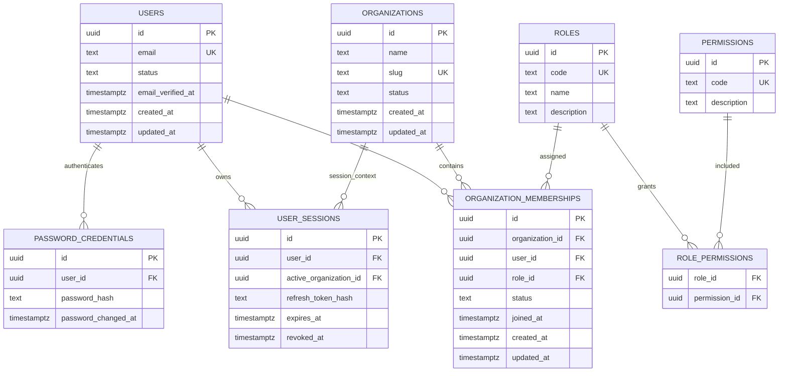

# Identity and Tenancy Architecture

**Status:** Proposed — pending implementation and review  
**Ticket:** DB-006  
**Scope:** Identity, organization membership, authorization, and tenant isolation  
**Database:** PostgreSQL  
**Backend:** Go modular monolith

---

## 1. Purpose

This document defines how OMICX identifies users, represents organizations, manages organization membership, and enforces tenant-level authorization.

The architecture must support:

- One human user having memberships in multiple organizations.
- One organization having many users.
- Different roles for the same user in different organizations.
- Strict separation of tenant-owned data.
- Centralized authentication and organization-scoped authorization.
- Future BPO workflows without prematurely introducing unnecessary organizational hierarchy.

## 2. Core architectural decisions

| Decision | Choice |
|---|---|
| Identity model | Global user identity |
| Tenant model | One organization represents one tenant in v1 |
| User-to-organization relationship | Many-to-many |
| Membership model | Explicit organization_memberships table |
| Role assignment | One role per membership in v1 |
| Permission model | Role-based permissions |
| Password storage | Argon2id password hashes |
| Session storage | Database-backed sessions with hashed refresh tokens |
| Tenant isolation | Application authorization + PostgreSQL RLS |
| Database access | Restricted application role |
| BPO hierarchy | Deferred until validated by real customer requirements |

## 3. Identity versus tenancy

These concepts must remain separate.

### User

A user represents a human identity across the entire OMICX platform.

A user is not owned by an organization.

Example:

- User ID: `user_001`
- Email: `ahmed@example.com`

The user can belong to multiple organizations without creating duplicate identity records.

### Organization

An organization represents a company using OMICX.

An organization is the tenant boundary in v1.

Example:

- Organization ID: `org_001`
- Name: `Alpha Support`

All operational data belonging to this organization must be tenant-scoped.

### Membership

A membership represents a user's relationship with an organization.

It determines:

- Which organization the user belongs to.
- Which role the user has in that organization.
- Whether the membership is active, suspended, or revoked.

Example:

| User | Organization | Role |
|---|---|---|
| Ahmed | Alpha Support | Owner |
| Ahmed | Beta Solutions | Supervisor |

One user can have different roles in different organizations.

## 4. Entity relationship model



This is a conceptual model. The actual migration may add constraints, indexes, and additional security fields.

## 5. Table responsibilities

### 5.1 users

Purpose: Store global human identities.

Rules:

- Each user has one globally unique canonical email.
- Email normalization is performed consistently before persistence.
- User identity is independent of organization membership.
- A user can exist without an organization membership.
- Account status controls whether authentication is allowed.

Suggested statuses:

- `active`
- `suspended`
- `disabled`

Do not add `organization_id` or `role_id` to this table.

### 5.2 organizations

Purpose: Represent tenants.

Rules:

- Each organization has a unique slug.
- Organization status controls whether normal tenant operations are permitted.
- Organization-owned records must reference the organization.
- An organization cannot access another organization's operational data.

Suggested statuses:

- `active`
- `suspended`
- `closed`

### 5.3 organization_memberships

Purpose: Connect global users to organizations.

Rules:

- A user can have multiple memberships.
- An organization can have multiple members.
- `(organization_id, user_id)` must be unique.
- Each membership has exactly one role in v1.
- Membership status is independent of user status.
- Revoking a membership must not delete the global user account.

Suggested statuses:

- `active`
- `invited`
- `suspended`
- `revoked`

A user with a suspended membership in one organization may still have an active membership in another.

### 5.4 roles

Purpose: Define organization-level responsibility categories.

Initial built-in roles:

| Code | Purpose |
|---|---|
| owner | Organization ownership |
| admin | Organization administration |
| supervisor | Operational supervision |
| agent | Customer support operations |
| analyst | Read-only reporting and analytics |
| billing_admin | Billing and subscription management |

These are global built-in role definitions in v1.

The role assigned to a user is stored on the membership, not on the global user.

### 5.5 permissions

Purpose: Define individual capabilities.

Initial examples:

```text
conversation.read
conversation.assign
conversation.close

contact.read
contact.update

team.read
team.manage

agent.read
agent.manage

knowledge.read
knowledge.manage

analytics.read

billing.read
billing.manage

organization.read
organization.manage
```

A permission represents an action that the backend can authorize.

A role groups permissions through `role_permissions`.

The backend must check permissions, not simply trust a role name supplied by a client.

### 5.6 role_permissions

Purpose: Map roles to permissions.

Rules:

- A role can have many permissions.
- A permission can belong to many roles.
- `(role_id, permission_id)` must be unique.
- Built-in permission assignments should be managed through versioned migrations or controlled seed logic.

### 5.7 password_credentials

Purpose: Keep authentication secrets separate from public user identity data.

Rules:

- Never store plaintext passwords.
- Store Argon2id password hashes in PHC format.
- Benchmark and configure the hashing parameters.
- Never log password hashes.
- Password changes must update the password-change timestamp.

### 5.8 user_sessions

Purpose: Track authenticated sessions.

Rules:

- Store hashes of refresh tokens, never reusable raw refresh tokens.
- Support expiration and revocation.
- Associate each session with its authenticated user.
- An optional active organization may be stored as session context.
- A session's active organization is not proof of membership or authorization.
- Revalidate membership and permissions on protected requests.

## 6. Authentication flow

1. User submits email and password.
2. Backend looks up the canonical email.
3. Backend verifies the password hash.
4. Backend verifies that the user account is active.
5. Backend establishes an authenticated session.
6. Backend retrieves the user's active organization memberships.
7. User selects an organization if more than one is available.
8. Backend verifies that the selected membership is active.
9. Backend establishes the organization context for the request.
10. Authorization checks determine whether the requested operation is allowed.

Authentication answers:

**Who is this user?**

Authorization answers:

**What can this user do in this organization?**

These are separate security responsibilities.

## 7. Multi-organization behavior

Example:

Ahmed belongs to two organizations.

| Organization | Membership role |
|---|---|
| Alpha Support | Owner |
| Beta Solutions | Supervisor |

When Ahmed selects Alpha Support, permissions are evaluated through his Alpha Support membership.

When he selects Beta Solutions, permissions are evaluated through his Beta Solutions membership.

Changing the active organization must never grant permissions from the previous organization.

The backend must not use a user's first membership as an implicit default.

## 8. Tenant isolation

Every tenant-owned operational table must contain `organization_id`.

Examples:

- contacts
- conversations
- messages
- teams
- agents or organization-scoped agent profiles
- assignments
- knowledge documents
- workflows
- automation executions
- quality evaluations
- usage records

Global identity tables are exceptions:

- users
- password_credentials
- global permission definitions
- global built-in roles

Tenant-owned tables must use tenant-aware relationships.

Where one tenant-owned record references another, use composite foreign keys where appropriate.

Example:

```sql
UNIQUE (organization_id, id)
```

Then:

```sql
FOREIGN KEY (organization_id, contact_id)
REFERENCES contacts (organization_id, id)
```

This prevents a conversation belonging to one organization from referencing a contact belonging to another organization.

## 9. Row-Level Security

PostgreSQL Row-Level Security (RLS) is a second enforcement layer.

Application authorization and RLS serve different purposes:

- Application authorization determines whether a user may perform an operation.
- RLS restricts which tenant rows the database session can access.

The intended request lifecycle:

1. Authenticate the user.
2. Verify active organization membership.
3. Begin a database transaction.
4. Set the verified organization ID using transaction-local configuration.
5. Execute tenant-scoped queries.
6. Commit or roll back the transaction.

Example:

```sql
SELECT set_config(
    'app.current_organization_id',
    'verified-organization-uuid',
    true
);
```

The third argument makes the setting transaction-local.

Important:

- Never use a persistent session-level tenant setting with a connection pool.
- Never accept the organization context without server-side membership verification.
- RLS must be tested using `omicx_app`, not a superuser.
- The runtime role must not own the protected tables.
- The runtime role must not have `BYPASSRLS`.
- Consider `FORCE ROW LEVEL SECURITY` where appropriate.
- Test missing tenant context, cross-tenant access, and pooled connection reuse.

RLS is not considered implemented merely because a policy exists. It must be tested through the actual application database role.

## 10. Database privilege separation

Two database responsibilities must be separated.

### Migration account

Responsible for:

- Applying schema migrations.
- Creating and altering database objects.
- Managing schema changes.

### Application account

Responsible for:

- Reading and writing permitted application data.
- Executing normal runtime queries.
- Operating under RLS policies.

The application account must not:

- Be a superuser.
- Create databases.
- Create roles.
- Bypass RLS.
- Own protected tenant tables.

Production should use a dedicated least-privilege migration role rather than relying on a superuser.

## 11. Platform administrators

Platform administrators are not organization owners.

A platform administrator operates the OMICX platform itself.

An organization owner operates their own tenant.

Do not introduce a global `users.is_admin` field as a shortcut for platform administration.

Platform-level access requires a separate, explicitly designed authorization mechanism and audit trail.

## 12. Deferred decisions

The following are deliberately out of scope for v1:

- Multiple roles per membership.
- Organization-defined custom roles.
- ClientAccount / Program / Sector hierarchy.
- Complex BPO workforce hierarchy.
- Social identity providers.
- Enterprise SSO.
- Fine-grained resource-level sharing between organizations.

These should be introduced only when validated requirements justify their complexity.

## 13. Security and correctness acceptance criteria

- [ ] One user can have memberships in multiple organizations.
- [ ] One organization can have multiple users.
- [ ] A user can have different roles in different organizations.
- [ ] Duplicate memberships are rejected.
- [ ] Suspended memberships cannot authorize access.
- [ ] Revoked memberships cannot authorize access.
- [ ] Inactive users cannot authenticate.
- [ ] Passwords are never stored in plaintext.
- [ ] Refresh tokens are stored as hashes.
- [ ] Tenant-owned tables include organization ownership.
- [ ] Cross-tenant foreign-key references are rejected.
- [ ] API authorization is organization-scoped.
- [ ] RLS prevents cross-tenant access.
- [ ] Missing tenant context fails closed.
- [ ] Connection-pool reuse cannot leak tenant context.
- [ ] Runtime database account is not a superuser or table owner.
- [ ] Platform administration is separated from tenant roles.

## 14. Implementation sequence

| Step | Deliverable |
|---|---|
| DB-006-A | Separate migration and application database accounts |
| DB-006-B | Review and approve identity/tenancy architecture |
| DB-006-C | Create identity and tenancy migration |
| DB-006-D | Seed built-in roles and permissions |
| DB-006-E | Implement identity and membership domain models |
| DB-006-F | Implement authentication and session management |
| DB-006-G | Implement organization selection and authorization |
| DB-006-H | Add tenant-aware database access |
| DB-006-I | Enable and test RLS |
| DB-006-J | Add cross-tenant security integration tests |

No later phase should be marked complete without its acceptance tests.
