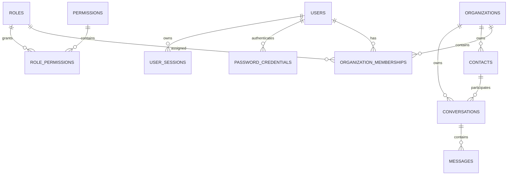

# OMICX Database Architecture & Implementation Guide

**Project:** OMICX  
**Database:** PostgreSQL 17  
**Schema:** `omicx`  
**Migration Tool:** Tern  
**Backend:** Go Modular Monolith  
**Status:** Initial database foundation — identity and tenancy not yet implemented

---

# 1. Database Architecture

## 1.1 Technology Stack

| Component | Technology | Responsibility |
|---|---|---|
| Database | PostgreSQL 17 | Persistent relational storage |
| Migration tool | Tern | Version-controlled SQL migrations |
| Database driver | pgx | Go/PostgreSQL communication |
| Application database role | omicx_app | Runtime database access |
| Migration database role | omicx_migrator | Schema changes |
| Tenant isolation | PostgreSQL RLS | Database-level tenant protection |

## 1.2 Database Organization

OMICX uses PostgreSQL schemas to organize database objects.

Initial structure:

```text
PostgreSQL Server
│
└── Database: omicx
    │
    ├── Schema: public
    │
    └── Schema: omicx
        │
        ├── users
        ├── organizations
        ├── organization_memberships
        ├── roles
        ├── permissions
        ├── role_permissions
        ├── password_credentials
        └── user_sessions
```

The structure above represents the intended identity foundation, not the current implemented database.

## 1.3 Database Responsibilities

The database is responsible for:

- Persistent application data.
- Referential integrity.
- Uniqueness constraints.
- Transactional consistency.
- Tenant data separation.
- Database-level security.
- Migration history.

Business authorization remains the responsibility of the Go application, supported by PostgreSQL RLS.

---

# 2. Identity and Organization Model

## 2.1 Users

The `users` table represents global human identities.

A user has one OMICX account regardless of how many companies they work for throughout their lifetime.

Example:

| id | email | status |
|---|---|---|
| user-001 | ahmed@example.com | active |

Rules:

- Email must be globally unique after normalization.
- A user is not owned by an organization.
- A user can exist without an organization.
- Passwords are not stored in this table.
- Account suspension is independent of organization membership.

## 2.2 Organizations

The `organizations` table represents companies using OMICX.

Each organization is an independent tenant.

Example:

| id | name | slug | status |
|---|---|---|---|
| org-001 | Alpha Support | alpha-support | active |
| org-002 | Beta Solutions | beta-solutions | active |

Each organization owns its operational data.

Examples:

- Contacts
- Conversations
- Messages
- Teams
- Knowledge documents
- Workflows
- Automation executions
- Analytics
- Usage records

An organization must never access another organization's private records.

## 2.3 Organization Memberships

The `organization_memberships` table connects users to organizations.

It represents an organizational affiliation over a period of time.

**Business rule: One user can have at most one current organization membership globally.**

Multiple historical memberships are allowed.

Example:

| User | Organization | Role | Status |
|---|---|---|---|
| Ahmed | Alpha Support | Agent | ended |
| Ahmed | Beta Solutions | Supervisor | active |

Membership statuses:

| Status | Meaning |
|---|---|
| invited | Invitation pending |
| active | Current membership |
| suspended | Temporarily blocked, still affiliated |
| ended | Historical membership |

An ended membership is never reactivated. Rejoining creates a new membership record.

A suspended membership still counts as current.

## 2.4 Database Enforcement

PostgreSQL must enforce the one-current-membership rule.

Intended index:

```sql
CREATE UNIQUE INDEX
organization_memberships_one_current_per_user
ON omicx.organization_memberships (user_id)
WHERE status IN ('active', 'suspended');
```

This index will be created in the membership migration, after the table exists.

Pending invitations do not count as current memberships.

Accepting an invitation must be transactional and must fail if the user already has a current membership.

## 2.5 Roles and Permissions

Roles describe organizational responsibilities.

Initial roles:

| Role | Responsibility |
|---|---|
| owner | Organization ownership |
| admin | Organization administration |
| supervisor | Team supervision |
| agent | Customer support |
| analyst | Reporting and analytics |
| billing_admin | Billing management |

Permissions describe individual capabilities.

Examples:

```text
conversation.read
conversation.assign
conversation.close
contact.read
contact.update
team.manage
agent.manage
knowledge.read
knowledge.manage
analytics.read
billing.read
billing.manage
organization.manage
```

A membership receives one role in v1.

Role-to-permission relationships are stored in `role_permissions`.

The backend checks permissions rather than trusting role names sent by clients.

---

# 3. Database Relationships

The intended entity relationships:



This is the target model. The operational tables will be introduced in their respective feature migrations.

---

# 4. Database Security

## 4.1 Database Roles

We separate two responsibilities.

**omicx_migrator**

- Creates tables.
- Alters database structures.
- Creates indexes.
- Applies migrations.

**omicx_app**

- Executes application queries.
- Reads and writes permitted data.
- Operates under RLS policies.
- Does not own protected tenant tables.
- Cannot bypass RLS.
- Is not a superuser.

The migration account must not be used as the normal API connection.

## 4.2 Row-Level Security

Every tenant-owned operational table must have an `organization_id`.

Example:

```sql
ALTER TABLE omicx.contacts
ENABLE ROW LEVEL SECURITY;
```

The application must:

1. Authenticate the user.
2. Verify their current membership.
3. Resolve their organization.
4. Begin a database transaction.
5. Set transaction-local organization context.
6. Execute tenant-scoped queries.
7. Commit or roll back.

Example:

```sql
SELECT set_config(
    'app.current_organization_id',
    'verified-organization-uuid',
    true
);
```

RLS policies will be implemented and tested in a later migration.

Missing tenant context must fail closed.

---

# 5. Local Development Environment

## 5.1 Prerequisites

Install:

- Docker Desktop
- Go
- Git
- Tern
- PostgreSQL client (`psql`)

## 5.2 Start PostgreSQL

Open PowerShell:

```powershell
cd D:\my_company\mgx\omicx\backend
```

Start the database:

```powershell
docker compose up -d
```

Check containers:

```powershell
docker ps
```

Expected OMICX container:

```text
NAME             STATUS
omicx-postgres   Up (healthy)
```

Expected port mapping:

```text
127.0.0.1:5433 -> 5432
```

Port 5433 is the host port. PostgreSQL listens on port 5432 inside the container.

## 5.3 Connect to PostgreSQL

```powershell
docker exec -it omicx-postgres psql -U omicx -d omicx
```

Inspect databases:

```sql
\l
```

Inspect schemas:

```sql
\dn
```

Inspect tables:

```sql
\dt omicx.*
```

Inspect a specific table:

```sql
\d omicx.users
```

Exit:

```sql
\q
```

Important: `-U omicx` uses the database role named `omicx`. Do not assume it is the restricted application role. Verify role attributes separately.

## 5.4 Inspect Database Roles

Inside psql:

```sql
SELECT
    rolname,
    rolsuper,
    rolcreatedb,
    rolcreaterole,
    rolbypassrls
FROM pg_roles
WHERE rolname IN (
    'omicx',
    'omicx_app',
    'omicx_migrator'
);
```

The runtime application account must not have superuser, role-creation, database-creation, or RLS-bypass privileges.

---

# 6. Migration Management with Tern

## 6.1 Why Migrations?

We never manually create application tables in the database.

Every structural change must be represented by a version-controlled migration.

Example:

```text
backend/
│
├── migrations/
│   ├── 001_create_omicx_schema.sql
│   ├── 002_identity_tenancy.sql
│   ├── 003_initial_roles_permissions.sql
│   └── ...
│
└── tern.conf
```

This ensures that:

- Every developer can reproduce the database.
- Database changes are reviewable.
- Migration history is tracked.
- Deployment uses the same schema changes.
- Rollbacks can be planned and tested.

## 6.2 Inspect Existing Migrations

From PowerShell:

```powershell
cd D:\my_company\mgx\omicx\backend

Get-ChildItem .\migrations
```

Inspect migration 001:

```powershell
Get-Content .\migrations\001_create_omicx_schema.sql
```

Inspect Tern configuration:

```powershell
Get-Content .\tern.conf
```

Do not expose database passwords when sharing configuration output.

## 6.3 Tern Migration Format

A migration contains an upward SQL section and an optional downward SQL section.

Example:

```sql
CREATE TABLE omicx.example (
    id UUID PRIMARY KEY,
    created_at TIMESTAMPTZ NOT NULL DEFAULT NOW()
);

---- create above / drop below ----

DROP TABLE omicx.example;
```

The first section applies the migration.

The second section reverses it.

Each migration is executed transactionally by Tern by default.

## 6.4 Check Migration Status

From the directory containing the actual `tern.conf`:

```powershell
tern status
```

This reports the database's current migration version and available migrations.

The migration configuration must point to the intended database.

## 6.5 Create a New Migration

After reviewing the current migration files:

```powershell
tern new identity_tenancy
```

Tern creates the next numbered migration.

For example:

```text
002_identity_tenancy.sql
```

The exact filename depends on the existing migration sequence.

Never assume the next number without inspecting the directory and migration status.

## 6.6 Review Before Applying

Before running a migration:

1. Review every CREATE TABLE statement.
2. Review primary and foreign keys.
3. Review unique constraints.
4. Review indexes.
5. Review status constraints.
6. Review tenant ownership.
7. Review the rollback section.
8. Verify the migration account and database connection.

## 6.7 Apply Migrations

From the directory containing the correct Tern configuration:

```powershell
tern migrate
```

This applies pending migrations through the latest version.

Check status afterward:

```powershell
tern status
```

## 6.8 Verify the Database

Connect:

```powershell
docker exec -it omicx-postgres psql -U omicx -d omicx
```

List tables:

```sql
\dt omicx.*
```

Inspect a table:

```sql
\d omicx.users
```

Check migration history using the version table configured for Tern:

```sql
SELECT * FROM public.schema_version;
```

The version table's actual name and schema must be verified from `tern.conf`; `public.schema_version` is only an example.

---

# 7. Identity and Tenancy Migration Plan

The identity foundation will be implemented in controlled steps.

| Migration | Responsibility |
|---|---|
| 001 | Create OMICX schema |
| 002 | Users, organizations, memberships, credentials, sessions, roles and permissions |
| 003 | Initial built-in role and permission assignments |
| 004 | Membership and authentication constraints refinements, if required |
| 005 | Tenant isolation foundation |

Migration 002 must be reviewed as one coherent identity schema before execution.

Do not create redundant migrations simply to separate related tables unnecessarily.

---

# 8. Implementation Acceptance Criteria

The identity database foundation is not complete until:

- [ ] Users table exists.
- [ ] Organizations table exists.
- [ ] Organization memberships table exists.
- [ ] Roles table exists.
- [ ] Permissions table exists.
- [ ] Role-permission relationships exist.
- [ ] Password credentials table exists.
- [ ] User sessions table exists.
- [ ] A user cannot have two current memberships.
- [ ] Historical memberships are preserved.
- [ ] Rejoining creates a new membership.
- [ ] Membership status constraints work.
- [ ] Foreign keys work.
- [ ] Required indexes exist.
- [ ] Application and migration database roles are separated.
- [ ] Database migrations run successfully.
- [ ] Migration rollback is tested where supported.
- [ ] Cross-tenant access tests pass.

---

# 9. Current Implementation Status

**Verified state as of November 18, 2026**

| Component | Status |
|---|---|
| PostgreSQL Docker container | Running |
| OMICX database | Exists |
| OMICX schema | Exists |
| Migration 001 | Previously reported as applied; verify Tern status |
| Users | Not implemented |
| Organizations | Not implemented |
| Memberships | Not implemented |
| RBAC | Not implemented |
| Authentication tables | Not implemented |
| RLS | Not implemented |
| Migration 002 | Not created/applied |

---

# 10. Development Rules

1. Never manually modify production database structures.
2. Every schema change must have a migration.
3. Never use the application account to apply migrations.
4. Never trust client-provided organization IDs without server-side verification.
5. Every tenant-owned record must have tenant ownership.
6. Never delete historical membership records merely because a user leaves.
7. Never mark a database feature complete without tests.
8. Review the SQL before executing it.
9. Test migrations against a clean local database.
10. Preserve database volumes during normal development.

**The database schema is the foundation of OMICX. Identity, tenancy and authorization must be correct before implementing the operational business domains.**